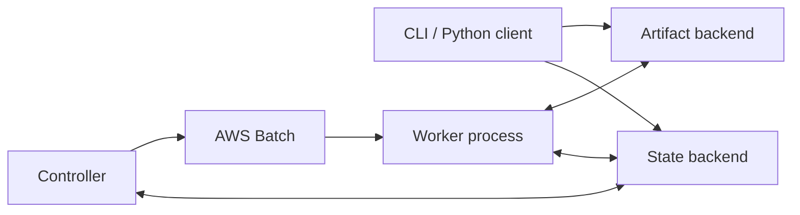

# Cloud execution

`provium-cloud` submits procedure and pipeline invocations to AWS Batch. It uses
`provium-pipeline` to plan dependencies, a state backend to coordinate work, and an
artifact backend to store verified inputs and outputs. It has no dependency on
`provium-dispatch`.

Pipeline graphs and deployment configurations have no registered name. Supply the
graph or procedure and its scheduling configuration when you enqueue a run.

For a disposable environment that builds an image, runs real AWS tests, and cleans
up afterward, use [Testing on AWS](cloud-testing.md). That tooling is separate from
the runtime, which expects infrastructure to exist already.

## Install

Python 3.12 or newer is required. From the repository root:

```bash
python -m pip install -e ./packages/provium \
  -e ./packages/provium-pipeline \
  -e './packages/provium-cloud[aws,postgres]' \
  -e ./examples/provium-text-pipeline
```

For a published release, install `provium-cloud[aws,postgres]` and your own procedure
packages. Install the same procedure and artifact packages in the submitting
application and the Batch worker image. Workers verify that their contract and
configuration match the admitted plan.

The package exports `CloudClient`, deployment models, `load_deployment`, and
`__version__`. See the [API reference](../reference/provium-cloud.md).

## Execution model



Enqueueing uploads artifact inputs and records a durable run. A controller must
remain running to admit ready nodes, submit jobs, reconcile their state, and
advance downstream work. Each worker claims a computation, renews its lease,
executes the procedure, stages outputs, and commits their references while it
still owns the lease.

The state backend is the authority for accepted results and run history. Batch
job metadata helps reconcile submissions; it does not replace durable state.
Artifact bytes and execution state are separate backend concerns.

## Configure an existing deployment

Save this as `deployment.yaml`, replacing the bucket, queue, and job definition:

```yaml
kind: CloudDeployment
provider: aws
region: us-east-1
state:
  backend: postgres
  options:
    connection_env: PROVIUM_CLOUD_DATABASE_URL
artifacts:
  backend: s3
  options:
    location: s3://YOUR_BUCKET/provium-cloud
defaults:
  job_queue: YOUR_JOB_QUEUE
  job_definition: YOUR_JOB_DEFINITION:1
  timeout: 5m
routes:
  - match: tags.counting
    timeout: 10m
```

Set `PROVIUM_CLOUD_DATABASE_URL` in every client, controller, and worker environment
that opens PostgreSQL state. The configured database must already exist; the
backend initializes its tables automatically. Put the environment variable's
**name**, rather than its secret value, in YAML: the deployment configuration is
stored in state and passed to Batch workers.

All participants must reach the same database and artifact namespace. For local
execution tests, `state.backend: sqlite` accepts `options.path`; `artifacts.backend:
file` accepts `options.location`. A SQLite file or local artifact directory on your
laptop is not automatically accessible to Batch containers. Use PostgreSQL and S3
for the distributed setup described here.

Scheduling starts with `defaults`, applies matching `routes` in file order, and
then applies invocation overrides. Supported exact selectors are `nodes.NAME`,
`procedures.ID`, and `tags.TAG`; these are not glob patterns. Later matching rules
win. Every selected task needs a resolved `job_queue` and `job_definition`.
Timeouts are integer seconds of at least 60, or durations such as `5m` and `1h`.

Queues select the AWS compute environments; the deployment does not create or
configure compute environments. Set CPU, memory, architecture, networking, IAM
roles, and the image in existing Batch job definitions and queues.

### Worker and controller requirements

The worker image needs the `provium` executable and the installed cloud, procedure,
and artifact packages. Its entrypoint must permit Batch's command override:
`provium cloud aws worker --computation ... --generation ... --attempt ...`.
The adapter supplies serialized configuration in `PROVIUM_CLOUD_DEPLOYMENT`;
Batch supplies `AWS_BATCH_JOB_ID`. The worker also needs its database connection
variable and artifact permissions. Configure credentials through the task/job
role and database secrets through your deployment's secret delivery mechanism.

The controller needs Batch submission, listing, description, tagging, cancellation,
and termination permissions, plus access to the state and artifact backends.
Workers need state and artifact access. Image-pull and log-write permissions belong
to the Batch execution role. The optional `logs` command additionally needs
CloudWatch read access.

The runtime does not provision these resources, inject database passwords, or
install a controller service. The [test harness](cloud-testing.md) supplies those
pieces specifically for its temporary environment.

## Enqueue a pipeline

Save this unnamed graph as `pipeline.yaml`:

```yaml
inputs:
  document: provium_text_pipeline_example.DocumentV1
nodes:
  tokens:
    procedure: provium_text_pipeline_example.TokenizeV1
    inputs:
      source: $inputs.document
  count:
    procedure: provium_text_pipeline_example.CountWordsV1
    tags: [counting]
    inputs:
      tokens: $nodes.tokens.destination
targets:
  count: $nodes.count.word_count
```

Create a typed artifact, validate the configuration, and inspect the plan:

```bash
printf 'one two two\n' > document.txt
provium artifact load provium_text_pipeline_example.DocumentV1 document.txt document.pa
provium cloud aws validate -d deployment.yaml
provium cloud aws plan -d deployment.yaml -f pipeline.yaml
```

`plan` resolves installed procedure contracts and scheduling without opening the
state or artifact backends or submitting jobs. `enqueue` records the run and its inputs:

```bash
provium cloud aws enqueue -d deployment.yaml -f pipeline.yaml \
  --input document=document.pa --request-id document-001
```

The command prints a JSON run record. Save its `id` for later commands. In another
process with access to the same backends, run:

```bash
provium cloud aws controller -d deployment.yaml
```

`--once` advances one reconciliation cycle; it does not wait for a whole pipeline.
`--interval` controls the controller loop and defaults to two seconds. Restarting
the controller resumes durable work. Multiple controllers coordinate through the
state backend's serialized transactions.

Select a subset of targets with repeatable `--target` flags. Each selection can be
a target alias or `nodes.NODE.OUTPUT`. Standalone procedure submissions use the
procedure's outputs directly:

```bash
provium cloud aws enqueue -d deployment.yaml \
  --procedure provium_text_pipeline_example.TokenizeV1 \
  --input source=document.pa
```

Use repeatable `--parameter KEY.PATH=VALUE` and `--tag TAG` for standalone procedure
configuration and routing. Standalone setup inputs use the prefix `setup_`, for
example `--input setup_scale=2`. Pipeline nodes express configuration, tags, and
setup bindings in the graph. Inputs use their declared artifact or value types;
artifact inputs are typed artifact files, not arbitrary text files.

### Override scheduling

```bash
provium cloud aws enqueue -d deployment.yaml -f pipeline.yaml \
  --input document=document.pa \
  --job-queue priority --job-definition worker:2 --timeout 15m

provium cloud aws plan -d deployment.yaml -f pipeline.yaml \
  --deployment-set defaults.job_queue=priority --region us-east-1
```

`--deployment-set KEY.PATH=VALUE` is repeatable and updates the deployment before
planning; `--region` overrides its region. Direct job overrides apply after routing
rules. A run retains the deployment and resolved task settings admitted with it;
editing a YAML file does not rewrite existing runs.

The runtime CLI does **not** load `.env` files automatically. The repository-root
[dotenv layering](cloud-testing.md#dotenv-precedence) belongs to the test harness.
Export variables or use your application's environment loader for ordinary runtime
commands and Python clients.

## Reuse, force, and retries

A computation is identified by the procedure record, including its contract and
configuration, and its input/setup identities. Graph names, node names, run IDs,
queues, and artifact filenames are not computation identity. Equivalent nodes
share work across different graphs and standalone invocations when they use the
same state backend and artifact namespace.

| Operation | Behavior |
| --- | --- |
| Normal enqueue | Reuse a verified completed result, or join equivalent active work. Otherwise schedule computation. |
| Same `request_id` and same request | Return the original run. Reusing the ID with different inputs, plan, or deployment is an error. |
| Enqueue without `request_id` | Create a new run record; computations can still be shared. |
| `--force` | Require another execution even when outputs exist. Equivalent pending/running forced work can be shared. |
| `--force-selector nodes.NAME` | Force only matching pipeline tasks; selectors also accept `procedures.ID` and `tags.TAG`. Repeat as needed. |
| `retry RUN_ID` | Reset unfinished tasks of a failed/canceled run, keeping completed tasks and the same run ID. |
| `cancel RUN_ID` | Cancel this run's demand; preserve work required by other active runs. |

A newer forced admission can replace queued settings and supersede submitted work
that has not claimed execution. Running ordinary work is allowed to finish before
its forced successor starts. Cancellation and supersession are reconciled with
Batch by the controller; they are not synchronous promises to stop a container
immediately. Completed forced work can be forced again by a later invocation.

Committed output references are accepted only from the current lease owner.
Missing or invalid cached bytes cause recomputation when detected during admission.
Workers with expired ownership cannot overwrite newer accepted results. A lease
expiry or job failure can fail the run; use `retry` after addressing the cause.

This is not a general exactly-once guarantee for arbitrary procedure side effects.
An ambiguous Batch submission response can leave duplicate container jobs; worker
claims prevent them from both executing the same admitted generation. Procedures
that call external systems still need idempotent operations, particularly across
retries after worker failure or lease loss. Use a new request ID for an intentional
new forced request; an old request ID still selects its original run.

## Inspect progress and retrieve results

Replace `RUN_ID`, `COMPUTATION_KEY`, and `JOB_ID` with returned identifiers:

```bash
provium cloud aws list -d deployment.yaml --status running --limit 20
provium cloud aws status -d deployment.yaml RUN_ID
provium cloud aws inspect -d deployment.yaml RUN_ID --node count
provium cloud aws wait -d deployment.yaml RUN_ID --timeout 600
provium cloud aws fetch -d deployment.yaml RUN_ID count result.pa
provium cloud aws lookup -d deployment.yaml COMPUTATION_KEY
provium cloud aws logs -d deployment.yaml JOB_ID --limit 100
```

`inspect --node` returns shared computation generations, including Batch job IDs,
or `null` if the task has not been admitted. `lookup` verifies and returns the
latest successful computation outputs under an `outputs` key, whose value is `null`
if none exist. `fetch` refuses to
overwrite an existing destination unless `--overwrite` is supplied. For a
standalone tokenize run, the output name is `destination` instead of `count`.

`wait` polls state; it does not run a controller. Its `--timeout` limits the local
wait and does not cancel jobs. It returns nonzero for failed/canceled runs or a
wait timeout. Successful management commands emit JSON; no `--json` flag is needed.

Run records expose `id`, `input_set_id`, `inputs`, `tasks`, `targets`, `outputs`,
status, timestamps, and errors. CLI output also contains `progress`: `total`,
`waiting`, `queued`, `running`, `completed`, `failed`, `blocked`, `canceled`, and
`reused`. In Python, access `run.progress` explicitly; it is a property rather than
a field in `run.model_dump()`.

A UI can display each run's input list, status, and `completed / total`, and filter
with `list --input-set-id ID` or repeated `--status`. Pagination returns
`next_cursor`; pass it as `--cursor`. There is no pipeline-definition/name filter
or built-in graphical interface. Task statuses and AWS container statuses are
related but distinct: an unclaimed Batch job may still be a queued cloud task.

## Python interface

With a controller running separately:

```python
from provium_cloud import CloudClient, __version__

with CloudClient.from_file("deployment.yaml") as client:
    run = client.enqueue_pipeline(
        "pipeline.yaml",
        {"document": "document.pa"},
        request_id="document-001",
    )
    result = client.wait(run.id, timeout=600)
    result.raise_for_failure()
    client.fetch(result.id, "count", "result.pa")
    print(__version__, result.id, result.progress)
```

`enqueue_procedure(identifier, inputs, configuration=..., tags=..., force=...)`
provides the standalone equivalent. To host a controller in your application:

```python
from provium_cloud import CloudClient
from provium_cloud.execution.controller import Controller

with CloudClient.from_file("deployment.yaml") as client:
    Controller(client).serve()
```

`serve(stop=threading.Event(), interval=2)` supports controlled shutdown. `tick()`
performs one cycle. See the [API reference](../reference/provium-cloud.md) for
backend contracts and dependency injection.

## Current boundaries

AWS Batch is the supplied execution adapter. State backends are PostgreSQL and
SQLite; artifact backends are S3 and local files. PostgreSQL artifact-blob storage,
infrastructure provisioning through the runtime CLI, pipeline registration, CSV
batch submission, automatic artifact garbage collection, and a GUI are not supplied.
Cloud execution currently supports single-value fields, not repeated/multi-value
procedure fields. The PostgreSQL backend serializes scheduling transactions per
artifact namespace; measure contention before scaling a controller fleet.
