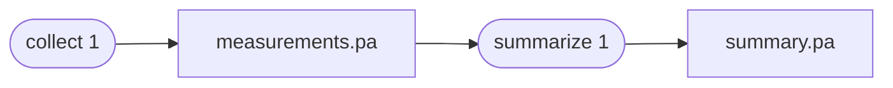

# Provium

**Typed artifacts with automatic provenance.**

Provium helps you build processing workflows whose results explain where they
came from. Store a result as an artifact, use that artifact as input to another
step, and save the new outputs as artifacts of their own. Provium records those
relationships automatically as your workflow runs.

Each processing step is represented by a versioned procedure. When a procedure
reads existing artifacts and creates new ones, Provium links the outputs to the
procedure and its inputs. That lineage travels with every result, including its
full upstream history.

## Features

- Typed readers and writers for application-specific artifact formats
- Automatic input, output, and procedure lineage
- SHA-256 payload integrity checks
- Streaming, body-relative I/O
- Runtime artifact discovery through Python entry points
- Optional configuration snapshots, including Pydantic v2 models
- Optional pipeline execution with verified reuse and PostgreSQL queues
- Optional S3 storage

[Get started](getting-started.md){ .md-button .md-button--primary }
[Core API](reference/provium.md){ .md-button }
[CLI API](reference/provium-cli.md){ .md-button }
